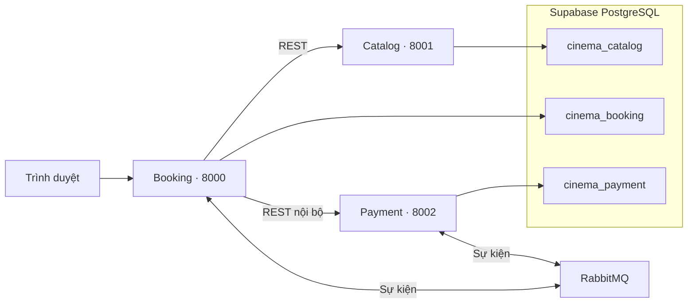
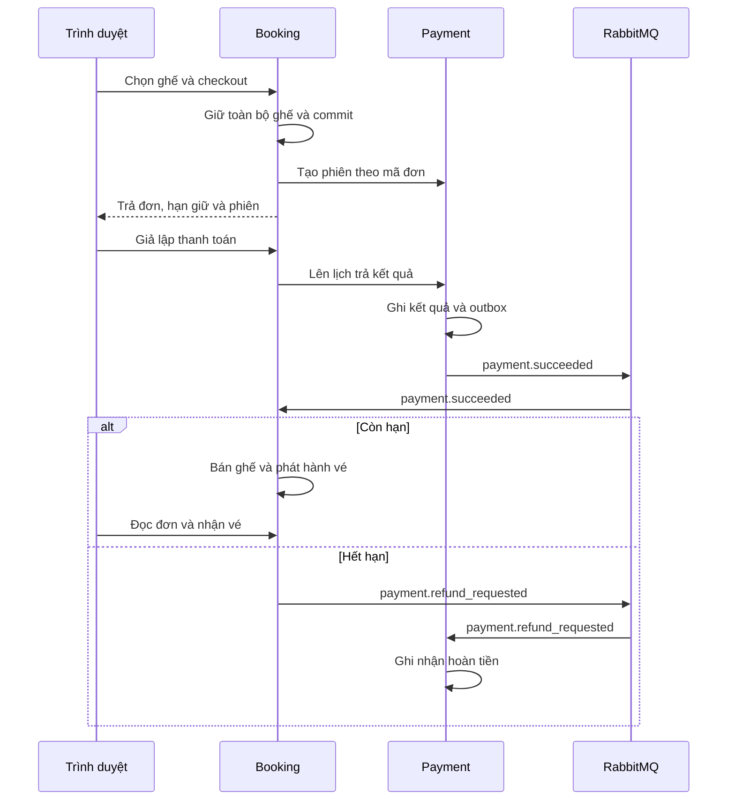

# Kiến trúc

| Thành phần | Trách nhiệm |
|---|---|
| Booking | Phục vụ giao diện web, xác thực tài khoản, giữ ghế, quản lý lịch sử và phát hành vé. |
| Catalog | Cung cấp phim, phòng, suất tương lai và sơ đồ ghế gốc qua REST. |
| Payment | Tạo phiên thanh toán nội bộ, xử lý kết quả giả lập và hoàn tiền. |
| RabbitMQ | Chuyển sự kiện thanh toán và hoàn tiền giữa Booking và Payment qua AMQP. Hai dịch vụ kết nối broker bằng Pika. |
| Supabase PostgreSQL | Một database chứa ba schema nghiệp vụ. Booking quản lý bảng tài khoản và phiên trong `cinema_booking`. |

Trình duyệt gọi Booking. Booking đọc lịch chiếu từ Catalog và gọi Payment bằng `X-Internal-Key`. Kết quả thanh toán thành công được xử lý bất đồng bộ qua RabbitMQ.

## Nhất quán dữ liệu và người dùng đồng thời

- Checkout khóa ghế theo suất và nhãn ghế trong PostgreSQL. Các ghế và liên kết lịch sử được ghi trong cùng giao dịch khi tạo đơn. Luật này áp dụng cho cả khách và người dùng đã đăng nhập.
- Booking và Payment lưu sự kiện vào outbox cùng giao dịch ghi trạng thái. RabbitMQ xác nhận việc nhận bản tin từ bên gửi. Bên nhận chỉ xác nhận đã xử lý sau khi giao dịch commit. Điều kiện trạng thái và khóa idempotency bảo vệ khi yêu cầu được gửi lại.
- Giao diện nhận tín hiệu SSE khi tiến trình Booking xử lý bán vé và tải lại sơ đồ mỗi 5 giây. PostgreSQL là nguồn trạng thái ghế dùng chung.
- Repository đóng gói truy vấn SQL theo schema. API dựng các repository và truyền vào use case, service qua constructor. [Design pattern](patterns.md), [hợp đồng API](../specs/contracts.md).
