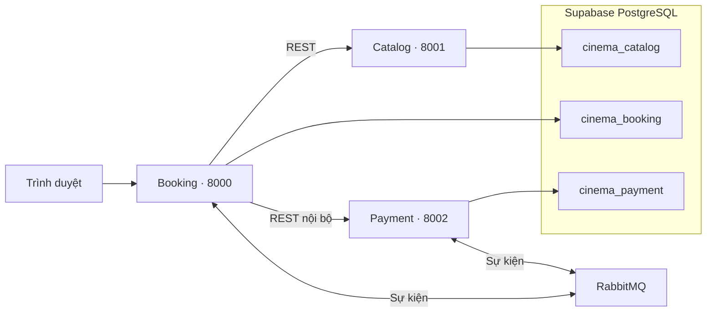
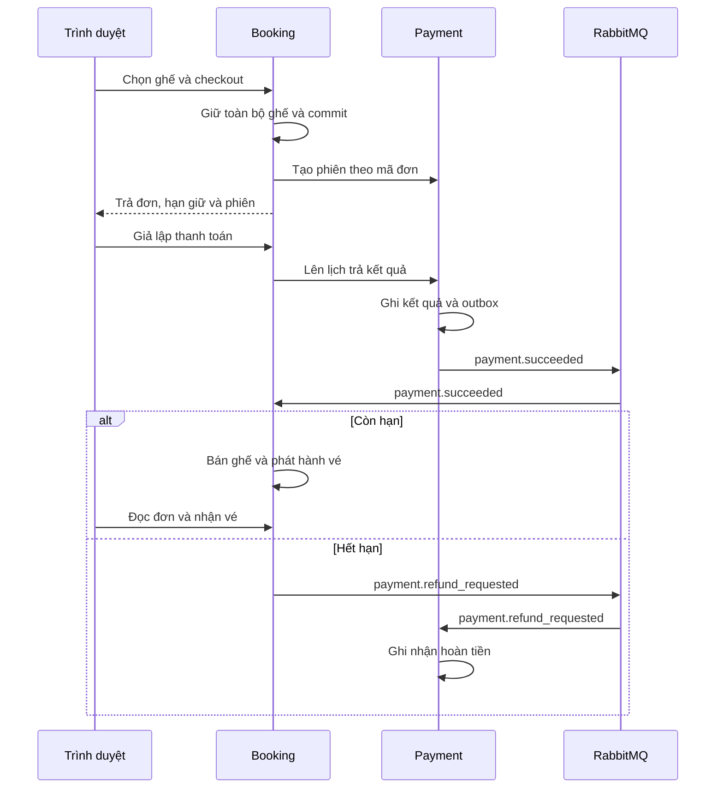

# Kiến trúc

Giá, ghế và vé thuộc Booking. Mỗi service giới hạn câu SQL trong schema riêng. Booking và Payment dùng outbox, RabbitMQ publisher confirm và consumer acknowledge sau commit để phục hồi khi mất kết nối.
